  

  
  

<h3><code>chris@github ~ $ ./now.sh</code></h3>

- 🤖 Building plugins, skills and multi-agent workflows for **Claude Code**
- ☁️ Running cloud infrastructure at **WorNet AG**: Apache CloudStack, LINSTOR/DRBD, networks, backups
- 💾 Built **Sentinel VMBackup**, a distributed backup and restore system for CloudStack on LINSTOR (my bachelor thesis, in production since Jan 2026)
- 🎓 **M.Sc. Computer Science (Applied AI)** at TH Rosenheim
- 🚀 Building my own products on the side

<h3><code>chris@github ~ $ ls ./claude-code-tooling</code></h3>

| Repo | What it does |
|---|---|
| [**inception**](https://github.com/XyndoX/inception) | Layered multi-agent orchestration: Architect, Forger, Point Man |
| [**agent-skills**](https://github.com/XyndoX/agent-skills) | Repo cleanup with MAP.md, deep scenario tests, a scored judge loop |
| [**sculpt**](https://github.com/XyndoX/sculpt) | Claude resculpts your setup from your own session history |
| [**agentdeck**](https://github.com/XyndoX/agentdeck) | Live agent dashboard in a Claude Code pane |
| [**simpane**](https://github.com/XyndoX/simpane) | iPhone and Android simulator screens inside a Claude Code pane |
| [**repograph**](https://github.com/XyndoX/repograph) | Obsidian-style repo graph pane |
| [**perch**](https://github.com/XyndoX/perch) | Multiplayer sessions for ACP coding agents |
| [**omnifocus-sync**](https://github.com/XyndoX/omnifocus-sync) | OmniFocus bridge for Obsidian |

<h3><code>chris@github ~ $ cat stack.txt</code></h3>

  
  
  
  
  
  

  
  
  
  
  

<h3><code>chris@github ~ $ exit</code></h3>

Terminal art is generated from a real font by <code>make_terminal_svg.py</code> in this repo. No third-party stats widgets.
